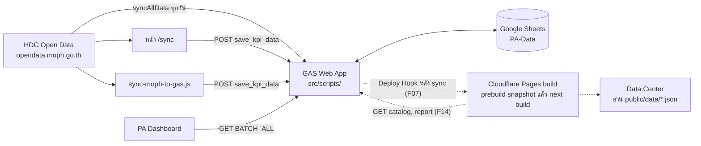

# Song Health Data Center · PA Dashboard

เว็บข้อมูลสุขภาพของอำเภอสอง จังหวัดแพร่ มี 2 ส่วน

- **PA Dashboard** หน้าตัวชี้วัด (KPI) ของ คปสอ.สอง ใช้งานอยู่ตอนนี้
- **Song Health Data Center** ศูนย์ข้อมูลสุขภาพของ สสอ.สอง จัดรายงานตาม หมวด → หัวข้อ → กลุ่ม → รายงาน ของ HDC เก็บข้อมูลย้อนหลัง 5 ปีงบประมาณ เฉพาะอำเภอสอง (กำลังพัฒนาในเฟส 1)

ข้อมูลทั้งหมดมาจาก [HDC Open Data](https://opendata.moph.go.th) ของกระทรวงสาธารณสุข เก็บใน Google Sheets ผ่าน Google Apps Script (GAS) และแสดงผลด้วย Next.js แบบ static export

## สถานะ

| | ตอนนี้ | หลังเฟส 1 |
|---|---|---|
| เว็บ | PA Dashboard ที่ <https://9gotstory.github.io/pa-dashboard/> บน GitHub Pages | Data Center ที่ `https://<project>.pages.dev/` และ PA ที่ `/pa` บน Cloudflare Pages (F21) |
| ข้อมูลที่หน้าเว็บอ่าน | PA เรียก GAS ทุกครั้งที่เปิดหน้า | Data Center อ่านไฟล์ JSON ที่สร้างตอน build (F14) ส่วน PA ยังเรียก GAS เหมือนเดิม |
| ลิงก์ GitHub Pages เดิม | ใช้งานปกติ | เหลือหน้า stub ส่งต่อไปโดเมนใหม่ (F22) |

- งานเฟส 1 แบ่งเป็น ticket F01–F22 ใน [FEATURES.md](FEATURES.md) เมื่อสร้าง issue แล้วติดตามสถานะได้ใน GitHub Issues
- ข้อความ "(F##)" ในไฟล์นี้หมายถึงสิ่งที่จะมีหลัง ticket นั้น merge ส่วนที่ไม่มีป้ายคือของที่ใช้ได้แล้ว
- branch `develop` (Backend v2: Fastify + PostgreSQL) ไม่ใช้แล้ว ดู [ADR-0001](docs/adr/0001-keep-gas-sheets-static-stack.md)

## ภาพรวมระบบ

เส้นประคือส่วนที่จะมีในเฟส 1



## หน้าเว็บ

ตอนนี้ทุก path อยู่ใต้ `/pa-dashboard/` ของ GitHub Pages

| path | ตอนนี้ | หลังเฟส 1 |
|---|---|---|
| `/` | PA Dashboard | หน้าแรก Data Center: แผนที่ตำบล หน่วยบริการ และหัวข้อรายงาน (F18) |
| `/pa` | — | PA Dashboard ย้ายมาที่นี่ หน้าตาและตัวเลขเหมือนเดิม (F13) |
| `/reports` | — | คลังรายงาน กรองตามหมวด/หัวข้อ และค้นหา (F19) |
| `/reports/{id}` | — | หน้ารายงาน: ร้อยละรายตำบล/รายหน่วยบริการ แนวโน้ม 5 ปี CSV (F20) |
| `/sync` | ดึงข้อมูลจาก MOPH เข้า Sheets ต้องใส่ PIN เลือกปีงบประมาณได้ และสั่ง rebuild ตอนจบ (F11) | เหมือนเดิม rebuild เริ่มทำงานเมื่อตั้ง Deploy Hook (F21) |

## โครงสร้าง repo

```text
src/
├── app/
│   ├── page.tsx, loading.tsx    PA Dashboard (ย้ายไป app/pa/ ใน F13)
│   ├── sync/page.tsx            หน้า /sync
│   └── (dc)/                    หน้าของ Data Center (F13–F20)
├── components/                  คอมโพเนนต์ของ PA ห้ามแก้ไฟล์เดิม
│   └── dc/                      คอมโพเนนต์ของ Data Center
├── lib/                         โค้ดของ PA ห้ามแก้ไฟล์เดิม
│   └── dc/                      type, การอ่าน snapshot และการคำนวณของ Data Center (F14–F15)
└── scripts/
    ├── รหัส.js, appsscript.json   โค้ด GAS (clasp push จากโฟลเดอร์นี้)
    ├── dc-*.js                     โค้ด GAS ส่วน Data Center (F01–F08)
    ├── test/                       เทสต์ GAS ด้วย node:vm (F01)
    └── สคริปต์ node อื่น            อยู่ใน .claspignore จึงไม่ถูก push ขึ้น GAS
public/
├── geo/                         ขอบเขตตำบล GeoJSON (F17)
└── data/                        snapshot ที่สร้างตอน build ไม่ commit (F14)
docs/
├── adr/                         บันทึกการตัดสินใจ
└── reference/                   ต้นแบบหน้าจอ R6 (ตัวเลขเป็นข้อมูลจำลอง)
tools/                           snippet สำหรับรันใน DevTools ของเบราว์เซอร์ (export แค็ตตาล็อก)
catalog-exports/                 ไฟล์ export แค็ตตาล็อกจาก snippet ไม่ commit
```

รายการไฟล์ที่ห้ามแก้แบบเต็มอยู่ใน [CODING_STANDARDS.md](CODING_STANDARDS.md) §1

## เริ่มพัฒนา

ต้องมี Node.js 24, npm (โปรเจกต์ใช้ `package-lock.json`) และอินเทอร์เน็ตตอน build เพราะ Next.js โหลดฟอนต์ Prompt กับ Sarabun จาก Google Fonts

```bash
git clone https://github.com/9GotStory/pa-dashboard.git
cd pa-dashboard
npm ci
```

สร้างไฟล์ `.env.local` (`.gitignore` กันไฟล์ `.env*` ไว้แล้ว)

```bash
NEXT_PUBLIC_GAS_SCRIPT_URL=https://script.google.com/macros/s/<deployment-id>/exec
NEXT_PUBLIC_SYNC_PIN_CODE=<PIN ของหน้า /sync>
```

| ตัวแปร | ใช้ที่ |
|---|---|
| `NEXT_PUBLIC_GAS_SCRIPT_URL` | หน้า `/sync`, สคริปต์ node และ prebuild snapshot (F14 บังคับต้องมี) ส่วน PA ใช้ URL ที่เขียนไว้ใน `src/lib/useKPIData.ts` ไม่ได้อ่านจากตัวแปรนี้ |
| `NEXT_PUBLIC_SYNC_PIN_CODE` | PIN ของหน้า `/sync` |

ตัวแปรที่ขึ้นต้นด้วย `NEXT_PUBLIC_` ถูกฝังในไฟล์ JavaScript ที่ส่งให้เบราว์เซอร์ จึงไม่ใช่ความลับ ([ADR-0005](docs/adr/0005-no-server-side-auth-phase1.md))

แล้วรัน `npm run dev` และเปิด <http://localhost:3000>

## คำสั่ง

| คำสั่ง | ทำอะไร |
|---|---|
| `npm run dev` | dev server |
| `npm run build` | build เป็นไฟล์ static ใน `out/` (ตั้งแต่ F14 ดึง snapshot จาก GAS ก่อน build) |
| `npx serve@latest out` | เปิดดูผล build (`npm start` เดิมใช้กับ static export ไม่ได้ F13 เปลี่ยนให้ใช้คำสั่งนี้) |
| `npm run lint` | ESLint |
| `npm test` | เทสต์ GAS และการคำนวณ (F01, F15) |
| `npm run snapshot` | ดึง snapshot อย่างเดียวโดยไม่ build (F14) |
| `npm run gas:push` · `gas:deploy` · `gas:sync` | push โค้ด GAS · deploy ทับ deployment เดิม · ทำทั้งสองอย่าง (ดูหัวข้อ Deploy) |
| `node src/scripts/sync-moph-to-gas.js [--only <table> ...] [--year <YYYY> ... \| --backfill] [--force] [--no-rebuild]` | sync จาก MOPH เข้า GAS โดยไม่ต้องเปิดเบราว์เซอร์ · ไม่ใส่ `--year` คือปีปัจจุบัน · ตอนจบสั่ง rebuild ถ้ามีตารางบันทึกสำเร็จ (F09) |
| `node src/scripts/verify-all.js` | ดึงจาก MOPH แล้วพิมพ์เป้าหมาย ผลงาน และร้อยละระดับอำเภอของแต่ละ KPI ไว้เทียบกับ PA |
| `node src/scripts/hdc-catalog.js find\|refresh --from <ไฟล์>` | ค้นว่าตารางอยู่หัวข้อไหนของ HDC และรีเฟรชแค็ตตาล็อก จากไฟล์ที่ snippet `tools/hdc-catalog-export.js` บันทึกจากเบราว์เซอร์ เพราะ API แค็ตตาล็อกไม่รับสคริปต์ (F10, ADR-0010) |

## Deploy

### เว็บ

- ตอนนี้: push เข้า `main` แล้ว GitHub Actions (`deploy.yml`) build และขึ้น GitHub Pages ใต้ `/pa-dashboard/` โดยอ่านตัวแปร 2 ตัวข้างบนจาก GitHub secrets · PR ที่เข้า `main` จะรัน `ci.yml` (`npm run build` และตั้งแต่ F01 รัน `npm test` ด้วย)
- F13 ปิด deploy อัตโนมัติขึ้น GitHub Pages (เหลือกดรันเองใน Actions) จนกว่าจะย้ายไป Cloudflare
- หลังเฟส 1: Cloudflare Pages build จาก `main` เอง และ GAS สั่ง build ใหม่ผ่าน Deploy Hook หลัง sync ได้ไม่เกิน 5 ครั้งต่อวัน ค่าที่ต้องตั้งอยู่ใน [SPEC.md](SPEC.md) §12.5 ส่วนหน้า stub อยู่ใน §12.6

### GAS

ครั้งแรกบนเครื่อง: ติดตั้ง clasp, เปิด Google Apps Script API ที่ <https://script.google.com/home/usersettings> แล้ว login

```bash
npm install -g @google/clasp
clasp login
```

ทุกครั้งที่ deploy

```bash
git switch main && git pull --ff-only
npm run gas:sync
```

- deploy จาก `main` เท่านั้น เพราะ PA กับ Data Center ใช้ GAS ตัวเดียวกัน
- `clasp push` แทนที่โค้ดบน Apps Script ทั้งโปรเจกต์ด้วยไฟล์ใน `src/scripts/` (ยกเว้นไฟล์ใน `.claspignore`)
- `gas:deploy` deploy ทับ deployment เดิม URL จึงไม่เปลี่ยน ห้ามสร้าง deployment ใหม่ เพราะ PA เขียน URL ไว้ในโค้ด
- Web App รันในนามผู้ deploy และเปิดให้ทุกคนเรียกได้ (`src/scripts/appsscript.json`)

## การ sync ข้อมูล

- **trigger รายวัน:** GAS รัน `syncAllData` ทุกวันช่วง 14:00–15:00 (เวลาไทย) สร้าง trigger ครั้งเดียวด้วยฟังก์ชัน `createDailyTrigger` ใน Apps Script editor และสั่งรันเองได้จากเมนู "PA Dashboard → Sync All Data Now" ในสเปรดชีต
- **หน้า `/sync` และสคริปต์ node:** ใช้เมื่อ trigger ดึงจาก MOPH ไม่สำเร็จ ทั้งสองทางดึงจาก MOPH แล้วส่ง `save_kpi_data` เข้า GAS
- ชีตแยกตามปีและการเก็บ 5 ปีมีรายละเอียดใน [SPEC.md](SPEC.md) §7 (F02)

## เอกสาร

| ไฟล์ | เนื้อหา |
|---|---|
| [SPEC.md](SPEC.md) | การออกแบบเฟส 1 ทั้งระบบ |
| [SCHEMA.md](SCHEMA.md) | โครงชีต สัญญา API ของ GAS ไฟล์ snapshot กติกาคำนวณ และ type |
| [FEATURES.md](FEATURES.md) | ticket F01–F22 เกณฑ์ตรวจรับ และกติกาการทำงาน |
| [GLOSSARY.md](GLOSSARY.md) | คำศัพท์ที่ใช้ในเอกสาร โค้ด และ issue |
| [docs/adr/](docs/adr/) | บันทึกการตัดสินใจและเหตุผล |
| [CODING_STANDARDS.md](CODING_STANDARDS.md) | มาตรฐานที่ใช้ตรวจโค้ดก่อน merge |
| [CLAUDE.md](CLAUDE.md) | คำสั่งสำหรับ Claude Code |
| [ต้นแบบหน้าจอ R6](docs/reference/song-health-data-center-review-03-epi-real-response-r6.html) | แบบหน้าตาและการใช้งานของ Data Center (ตัวเลขเป็นข้อมูลจำลอง) |

## วิธีทำงาน

พัฒนาด้วย Claude Code และ [mattpocock/skills](https://github.com/mattpocock/skills) โดยใช้ GitHub Issues เป็นที่เก็บงาน

1. ติดตั้งครั้งเดียว: `claude plugin install mattpocock-skills@claude-plugins-official` แล้วรัน `/setup-matt-pocock-skills`
2. งานใหม่: `/to-spec` สรุปเป็น spec issue แล้ว `/to-tickets` แตกเป็น ticket พร้อมลำดับที่ต้องรอกัน
3. ต่อ ticket: สร้าง branch `feat/F##-<slug>` จาก `main` → `/implement #<issue>` (เขียนเทสต์ตาม seam ที่ตกลงไว้และ code review ในตัว) → เปิด PR เข้า `main` → squash merge
4. งานที่ต้องคนทำเอง เช่นตั้งค่า Cloudflare: ให้ Claude ใช้ skill `wizard` สร้างสคริปต์นำทีละขั้น
5. จบแต่ละชุดงาน: `/retro`

ห้าม push ตรงเข้า `main` และต้องใช้ Context7 หาเอกสารของ library ก่อนเขียนโค้ด กติกาเต็มอยู่ใน FEATURES.md หัวข้อ "กติกา" และ [CLAUDE.md](CLAUDE.md)

## ที่มาของข้อมูล

- ตัวชี้วัดและรายงาน: [HDC Open Data](https://opendata.moph.go.th) กระทรวงสาธารณสุข
- ขอบเขตตำบล: MOPH GIS ที่มาและวันที่ดาวน์โหลดจะบันทึกใน `public/geo/README.md` (F17)
- แผนที่พื้นหลัง: © OpenStreetMap contributors (F18)
